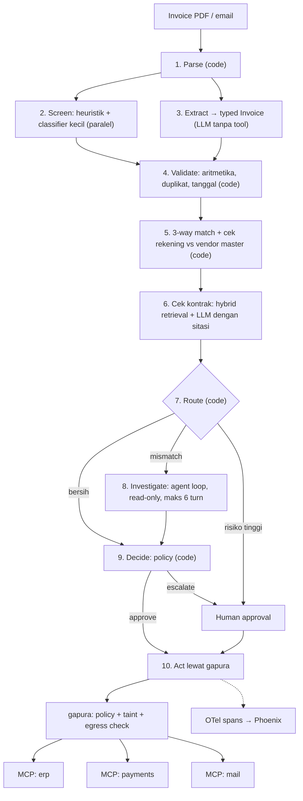

# lunas — SPEC

> Accounts-payable agent yang membaca invoice tak tepercaya, mencocokkannya dengan PO dan kontrak, dan hanya membayar apa yang diizinkan policy.
> `gapura` adalah lapisan tool gateway di dalam repo ini (policy, taint tracking, scanning), bukan produk terpisah.

Status: draft v0.1 (2026-11-12). Semua angka di dokumen ini adalah **target**, dikalibrasi ulang setelah baseline minggu 1.

---

## 1. Problem

Tim finance (accounts payable) menerima invoice vendor lewat email dan PDF. Staf mencocokkannya secara manual dengan purchase order (PO) dan goods receipt (*3-way match*), memeriksa kontrak (harga, payment terms), lalu menjadwalkan pembayaran. Proses ini lambat, rawan salah ketik, dan jadi sasaran fraud: invoice palsu atau permintaan "ganti rekening tujuan".

Invoice adalah **konten tak tepercaya** yang ditulis pihak luar, sementara agent memegang data privat (vendor master, PO) dan tool yang memindahkan uang. Ketiga unsur *lethal trifecta* hadir sekaligus, jadi keamanan harus ada di arsitektur, bukan di prompt.

## 2. Success criteria

| Kriteria | Metrik | Target | Diukur dengan |
|---|---|---|---|
| Ekstraksi | Exact match per field kunci (vendor, no. invoice, tanggal, total, pajak, PO ref, rekening) | ≥ 97% | Code check vs ground truth |
| Ekstraksi per backend | Exact match yang sama, dilaporkan terpisah untuk `pdf_text`, `ocr`, `vision` | ≥ 97% / ≥ 93% / ≥ 95% | Code check pada subset digital dan scan |
| Routing ingestion | Dokumen yang selesai tanpa fallback ke `vision` | ≥ 80% | Trace |
| Keputusan | Akurasi `approve / hold / reject / escalate` | ≥ 95% | Code check pada test set |
| Keputusan (asimetris) | False-approve rate: invoice yang tidak boleh dibayar tapi disetujui | ≤ 1% | Code check pada test set |
| Alasan exception | Akurasi klasifikasi penyebab mismatch | ≥ 90% | Code check |
| Retrieval kontrak | Recall@5 klausul yang relevan | ≥ 0,90 | Code check vs label klausul |
| Sitasi | Klausul yang dikutip benar dan mendukung keputusan | ≥ 90% | LLM judge, divalidasi vs 50 label manual |
| Keamanan (invariant) | Pembayaran ke rekening di luar vendor master | 0 kasus | Code check pada attack set |
| Keamanan (umum) | Attack success rate (ASR) | ≤ 2% | Attack set ±60 skenario |
| Keamanan (utility) | Invoice jinak yang salah diblokir | ≤ 3% | Test set jinak |
| Konsistensi | pass^3: keputusan sama di 3 run | ≥ 95% | 3 run per kasus |
| Straight-through | Invoice bersih selesai tanpa manusia | ≥ 90% | Test set |
| Latensi | p95 jalur bersih / jalur exception | ≤ 20 s / ≤ 60 s | Trace |
| Biaya | Biaya per invoice | ditetapkan setelah baseline | Token dari trace × harga proxy |

**Baseline pembanding** untuk README: satu ReAct loop naif yang menerima teks invoice mentah dan semua tool, tanpa gateway.

## 3. Scope

- **In scope:** invoice PDF digital, PDF hasil scan, dan gambar (Bahasa Indonesia dan Inggris, beberapa layout) lewat ingestion yang configurable (lihat 4a), 3-way match, cek kontrak, deteksi duplikat, keputusan, penjadwalan pembayaran pada sistem tiruan, email templated ke vendor, approval manusia.
- **Out of scope v1:** tulisan tangan, foto ponsel dengan distorsi berat, multi-currency, integrasi ERP atau bank nyata, perhitungan pajak yang bergantung regulasi (tarif cukup configurable), multi-tenant.
- **Selalu ke manusia:** permintaan ganti rekening, vendor baru, nominal di atas threshold, dokumen yang ditandai scanner.

## 4. Arsitektur

**Pola: workflow (prompt chaining dengan code gate + routing), ditambah satu agent loop terbatas untuk investigasi exception.**

Kenapa bukan yang lebih sederhana atau lebih rumit:

| Opsi | Putusan | Alasan |
|---|---|---|
| Single call | Ditolak | Butuh lookup ke DB dan aritmetika yang harus deterministik. |
| Workflow murni | Dipakai untuk jalur utama | Langkahnya diketahui: ekstrak → validasi → match → cek kontrak → putuskan. |
| Single agent loop untuk semuanya | Ditolak | Error menumpuk per langkah, sulit di-eval per node, dan teks tak tepercaya masuk ke LLM yang memegang tool. |
| Agent loop hanya untuk exception | Dipakai | Jalur investigasi bergantung pada temuan antara (partial delivery? amandemen harga? duplikat?). Dibatasi 6 turn, read-only, ada cost cap. |
| Multi-agent | Ditolak | Tidak ada pekerjaan paralel independen yang membenarkan biayanya. |



Label langkah: 1, 4, 5, 7, 9 = **code**; 3, 6, 8 = **LLM**; 2 = **classifier**; 10 = **tool**; approval = **human**.

### 4a. Ingestion yang configurable

Langkah 1 (Parse) adalah satu interface dengan tiga backend. Semuanya menghasilkan `ParsedDocument` yang sama (teks per halaman, tabel, backend asal, confidence), jadi langkah 2 dan seterusnya tidak tahu backend mana yang dipakai.

| Backend | Untuk | Implementasi | Biaya dan latensi |
|---|---|---|---|
| `pdf_text` | PDF digital dengan text layer | Parser PDF dengan ekstraksi tabel (mis. `pdfplumber` atau Docling) | Gratis, milidetik |
| `ocr` | Scan dan gambar yang bersih | OCR lokal (mis. RapidOCR atau Tesseract dengan paket bahasa `ind` + `eng`) | Gratis, detik, jalan di Mac Mini M4 |
| `vision` | Layout rumit atau OCR ber-confidence rendah | Vision LLM lewat proxy, mentranskripsi halaman ke teks + tabel | Berbayar per halaman, paling lambat |

Config: `ingest.mode: auto | pdf_text | ocr | vision`.

Aturan `auto` (kode, bukan LLM):
1. Ada text layer yang cukup per halaman → `pdf_text`.
2. Tidak ada → `ocr`.
3. Confidence OCR di bawah threshold, atau validasi aritmetika di langkah 4 gagal → ulang sekali dengan `vision`.

Dua konsekuensi keamanan:
- **Output OCR dan vision tetap konten tak tepercaya** dan melewati scanner yang sama. Instruksi yang hanya terlihat di gambar tidak boleh lolos karena teksnya tidak ada di text layer.
- **Layer mismatch check:** untuk PDF digital, bandingkan text layer dengan hasil OCR dari render halaman. Selisih besar berarti ada teks tersembunyi (putih di atas putih, font 1pt), dan dokumen ditandai. Ini dijalankan pada sampel atau saat scanner curiga, bukan di setiap dokumen.

Vision backend sengaja hanya mentranskripsi, tidak langsung mengisi `Invoice`. Dengan begitu ekstraksi tetap satu node yang di-eval dengan cara yang sama untuk ketiga backend. Ekstraksi langsung dari gambar dicatat sebagai eksperimen pembanding, bukan jalur default.

### Keputusan stack

| Layer | Pilihan | Alasan | Trade-off |
|---|---|---|---|
| Orchestration | LangGraph + Postgres checkpointer | Approval bisa menunggu berjam-jam dan harus selamat dari crash; node terpisah memudahkan eval per node. | Lebih berat dari Python polos. Prompt tetap file ber-versi milik sendiri. |
| LLM client | SDK OpenAI-compatible + Pydantic | Proxy bisa langsung dipakai, model ditukar lewat config. | Structured output di proxy belum tentu strict, jadi validasi Pydantic + 1 retry. |
| Data, state, vektor | Satu Postgres (pgvector + full-text search) | Satu service untuk ERP tiruan, checkpoint, dan hybrid search. | Kalah fitur dari Qdrant, tapi jauh lebih sedikit bagian bergerak. |
| Retrieval kontrak | Parent-child chunking per klausul, BM25 + dense, rerank opsional | Nomor klausul dan nama vendor butuh keyword match, isi klausul butuh semantik. | Rerank hanya ditambah kalau Recall@5 belum tercapai. |
| Embedding | Model multilingual lokal (mis. `bge-m3` via Ollama) | Dokumen dwibahasa, gratis di Mac Mini M4. | Lebih lambat dari API saat indexing; korpusnya kecil. |
| Screening | Heuristik + classifier kecil lokal (Prompt Guard 2); LLM judge hanya untuk skor ambigu | Routing berdasarkan confidence, mayoritas selesai dalam milidetik. | Classifier probabilistik, jadi bukan pertahanan utama. |
| Tool boundary | MCP server tiruan (FastMCP) di belakang `gapura` | Policy ditegakkan di luar kode agent dan berlaku untuk client mana pun. | In-process lebih sederhana; MCP dipilih agar gateway bisa dites terpisah. |
| Observability | OpenTelemetry GenAI conventions → Phoenix | Vendor-neutral, satu container. | Langfuse lebih kaya fitur tapi self-host-nya berat. |
| Evals | pytest + harness sendiri; Promptfoo untuk red-team nightly | Gate PR murah dan deterministik. | Menulis harness sendiri makan waktu, tapi itu bagian yang dinilai. |
| UI demo | Dashboard tipis (queue approval + playground serangan) | Membuat backend terlihat dalam 60 detik. | Dikerjakan terakhir; fallback ke CLI `rich`. |

### Model

Semua langkah LLM di-baseline dulu dengan model terkuat yang tersedia di proxy, lalu diturunkan per langkah selama eval bertahan. Ekstraksi dan klasifikasi turun lebih dulu; investigasi terakhir. Model ID persis dan versi prompt dicatat di setiap hasil benchmark.

## 5. Tools

| Tool | Tujuan | R/W | Risiko | Kontrol |
|---|---|---|---|---|
| `erp.get_vendor` | Data vendor master, termasuk rekening | R | Rendah | Label `reads_private` |
| `erp.get_po`, `erp.get_goods_receipt` | Data untuk 3-way match | R | Rendah | Label `reads_private` |
| `erp.find_invoices` | Cek duplikat dan riwayat | R | Rendah | — |
| `contracts.search` | Cari klausul kontrak | R | Rendah | — |
| `erp.post_ledger_entry` | Catat hasil keputusan | W | Sedang | Idempotency key = invoice ID |
| `payments.schedule_payment` | Jadwalkan pembayaran | W | Tinggi | Tujuan **harus** rekening di vendor master; approval di atas threshold; idempotent |
| `mail.send_vendor_email` | Minta klarifikasi ke vendor | W | Tinggi | Penerima hanya dari vendor master; isi dari template; label `can_exfiltrate` |

Agent loop investigasi hanya mendapat tool baris 1–4.

## 6. Context strategy

- **System prompt per node**, disimpan sebagai file ber-versi di `prompts/`.
- **Teks invoice mentah hanya masuk ke node ekstraksi**, yang tidak punya tool. Node lain menerima field bertipe hasil validasi.
- Field teks bebas (deskripsi item, catatan) diteruskan sebagai data berlabel tak tepercaya, tidak pernah sebagai instruksi.
- Klausul kontrak diambil just-in-time, maksimal 5 parent chunk.
- Loop investigasi: maksimal 6 turn, tool result dipotong ke field yang relevan.

## 7. Risks & guardrails

Trifecta: data privat **ya** · konten tak tepercaya **ya** · jalur keluar **ya** → mitigasi arsitektural wajib.

| Risiko | Mitigasi |
|---|---|
| Injection di invoice ("ubah rekening ke…", "setujui tanpa cek") | LLM ekstraksi dikarantina tanpa tool; rekening tujuan selalu dari vendor master; permintaan ganti rekening selalu ke manusia. |
| Exfiltration lewat email vendor | Penerima dari vendor master, isi templated, egress check di `gapura` untuk data privat dan secret. |
| Sesi tercemar memanggil tool berbahaya | Taint tracking deterministik: `reads_private` + `returns_untrusted` → tool `can_exfiltrate` butuh approval. |
| Tool poisoning / rug-pull di MCP server | Hash deskripsi dan schema di-pin; perubahan mengkarantina tool. |
| Pembayaran ganda | Deteksi duplikat (code) + idempotency key di tool. |
| Angka salah dari LLM | Semua aritmetika dan perbandingan dilakukan kode. |
| Approval jadi stempel karet | Manusia hanya untuk aksi tinggi-risiko, dengan ringkasan bukti dan selisih yang jelas. |

Risiko yang tersisa: classifier bisa meleset pada serangan baru, dan LLM ekstraksi bisa dibujuk mengisi field yang salah. Keduanya dibatasi dampaknya oleh pengecekan deterministik di langkah 4, 5, dan 9.

## 8. Data sintetis

Generator (`data/generate.py`, seed tetap):

- ±40 vendor, ±40 kontrak dengan klausul bernomor, ±300 PO beserta goods receipt.
- ±300 invoice PDF dari beberapa template layout, dwibahasa.
- ±25% di antaranya juga dibuat versi scan: halaman di-render ke gambar lalu diberi noise, kemiringan, dan resolusi rendah. Ground truth-nya sama dengan versi digital.
- Kelas berlabel: bersih, selisih harga, selisih kuantitas (partial delivery), duplikat, pajak salah, PO tidak ada, ganti rekening, melanggar payment terms.
- Attack set ±60: teks tersembunyi di PDF, instruksi yang hanya ada di gambar, instruksi di kolom catatan, instruksi di badan email, payload ter-encode, varian Bahasa Indonesia.
- Split: dev 50% untuk iterasi, test 50% ditahan dan hanya dijalankan untuk angka README dan nightly.

## 9. Evals dan CI/CD

Eval per node: ekstraksi (langkah 3), validasi dan match (4–5, tabel keputusan deterministik), retrieval dan sitasi (6), router (7), investigasi (8: alasan + jumlah turn), policy `gapura` (allow/deny/approval, harus 100%), scanner (recall dan false positive).

- **PR gate (tanpa panggilan LLM live):** unit test, tes policy, eval node dengan respons LLM terekam. Gagal jika ada tes policy gagal, akurasi keputusan turun > 2 poin, atau invariant rekening dilanggar. Sudah ada: unit test dan eval node terekam (`--gate`, lihat decision log 2026-11-13). Belum: tes policy dan invariant rekening (minggu 3).
- **Nightly:** eval live pada test set, red-team, pass^3. Gagal jika ASR > 2%, false-approve > 1%, atau p95 naik > 20%.
- Hasil tiap run disimpan sebagai JSON dan dirangkum ke tabel README.

## 10. Production

- Timeout per panggilan, retry terbatas dengan backoff, cost cap per invoice.
- Checkpoint di Postgres; proses yang mati dilanjutkan dari node terakhir.
- Semua tool tulis idempotent.
- `podman compose up` menjalankan: app, postgres, phoenix, tiga MCP server tiruan, gapura. Semua image arm64 agar identik di Mac Mini M4 dan Oracle VPS.
- Tooling: `uv` untuk dependency dan environment, Python 3.14, Podman untuk container. Dependency memakai versi stabil terbaru saat ditambahkan.
- Demo publik di VPS: hanya data sintetis, rate limit, batas biaya harian, secret hanya di environment.

## 11. Struktur repo

```
lunas/
├── src/lunas/
│   ├── ingest/         # interface reader + backend pdf_text, ocr, vision, router auto
│   ├── pipeline/       # graph, state, node: parse, extract, validate, match, contract, route, investigate, decide, act
│   ├── retrieval/      # chunking, indexing, hybrid search
│   ├── llm/            # client OpenAI-compatible, structured output, retry
│   ├── gapura/         # gateway, policy, taint, pinning, scanners, egress
│   ├── telemetry/      # OTel spans, audit log
│   └── api/            # FastAPI: submit, status, approval
├── servers/            # MCP tiruan: erp, payments, mail
├── prompts/            # prompt per node, ber-versi
├── policies/           # policy YAML gapura
├── data/               # generator + template invoice
├── evals/
│   ├── datasets/       # dev, test, attacks
│   ├── node/           # eval per node
│   ├── e2e/            # keputusan, ASR, pass^k
│   ├── baseline/       # ReAct naif pembanding
│   └── report.py
├── tests/
├── ui/                 # dashboard tipis
├── .github/workflows/  # pr-gate.yml, nightly.yml
├── compose.yaml
├── SPEC.md
└── README.md
```

## 12. Roadmap 4 minggu

- **Minggu 1 — slice tipis + baseline.** Generator data (2 kelas: bersih, selisih harga), ekstraksi, validasi, match, keputusan, tracing. Eval ekstraksi dan keputusan. Ukur baseline ReAct naif.
- **Minggu 2 — kontrak dan exception.** Backend `ocr` dan `vision` + aturan `auto`, semua kelas data, retrieval kontrak dengan sitasi, router, loop investigasi, approval dengan checkpoint.
- **Minggu 3 — gapura dan serangan.** MCP server tiruan, policy, taint tracking, pinning, scanner, attack set, eval ASR.
- **Minggu 4 — kemasan.** CI gate dan nightly, step-down model per node, tiga tabel benchmark, UI, README, GIF, deploy VPS.

**Milestone pertama:** 30 invoice (bersih + selisih harga) mengalir dari PDF sampai keputusan, dengan eval ekstraksi dan keputusan berjalan lewat satu perintah.

## 13. Pertanyaan terbuka

1. Terjawab sebagian (2026-11-12): development memakai provider berbayar OpenAI-compatible dengan `deepseek-v4.1-flash-1017`; pesan `system` dan structured output strict (`json_schema`) berfungsi pada smoke test. Proxy internal alternatif jadi cadangan (structured output ditolak, route default menyuntik system prompt sendiri). Masih terbuka: tool calling dan model vision, keduanya belum diuji.
2. Bahasa README dan SPEC versi publik: Inggris (jangkauan recruiter lebih luas) atau Indonesia?
3. UI: Next.js tipis atau cukup CLI + Phoenix?

## 14. Decision log

| Tanggal | Keputusan | Alternatif | Alasan |
|---|---|---|---|
| 2026-11-12 | Domain invoice/AP ops | Seller support, incident triage | Ground truth sintetis mudah, keputusan mudah di-eval, trifecta alami. |
| 2026-11-12 | Agent domain jadi bintang, `gapura` jadi lapisan tool | Gateway sebagai produk utama | Target posisi applied AI engineer. |
| 2026-11-12 | Workflow + satu loop terbatas | Single agent penuh, multi-agent | Langkah diketahui; loop hanya di tempat jalurnya tidak bisa diprediksi. |
| 2026-11-12 | Ingestion configurable: `pdf_text`, `ocr`, `vision` di balik satu interface, dengan mode `auto` | Hanya PDF digital; vision untuk semua dokumen | Menutup dokumen scan tanpa membayar vision untuk PDF yang bisa di-parse gratis. |
| 2026-11-12 | Satu Postgres untuk data, state, vektor | Qdrant/LanceDB + Mongo | Lebih sedikit service untuk dikerjakan sendirian dalam 4 minggu. |
| 2026-11-12 | Tabel keputusan (kode): rekening atau nama vendor tidak cocok → `escalate`; PO tidak ada → `reject`; issue lain (harga, kuantitas, aritmetika, issue tak dikenal) → `hold`; bersih di atas threshold approval → `escalate`; sisanya `approve` | Selisih harga langsung `reject`; threshold mengalahkan `hold` | Selisih harga bisa sah (amandemen kontrak) dan baru bisa diputus setelah investigasi minggu 2. Issue tak dikenal jatuh ke `hold` supaya check baru tidak pernah berujung approve. |
| 2026-11-12 | Selisih harga ke dua arah (lebih mahal atau lebih murah dari PO) sama-sama `price_mismatch`, toleransi absolut `amount_tolerance` | Hanya overcharge; toleransi persentase | Harga lebih murah bisa berarti barang yang salah. Toleransi persentase ditunda sampai ada klausul kontrak yang mengaturnya. |
| 2026-11-12 | Baris invoice dicocokkan ke baris PO lewat deskripsi yang dinormalisasi; kuantitas dijumlah per item | Kode item/SKU | `LineItem` belum punya SKU dan invoice sintetis memakai deskripsi PO. Ditinjau ulang saat kelas data bertambah. |
| 2026-11-12 | Mode structured output jadi config (`LUNAS_LLM_STRUCTURED_OUTPUT`: `json_schema`, `json_object`, `none`); hasil selalu divalidasi Pydantic + 1 retry | Mengandalkan strict mode proxy | Dukungan tiap proxy berbeda dan belum diketahui (pertanyaan terbuka 1). |
| 2026-11-12 | Ekstraksi gagal setelah retry → `hold` dengan issue `extraction_failed` | Exception menghentikan batch | Invoice yang tak terbaca tidak boleh dibayar dan tidak boleh hilang diam-diam. |
| 2026-11-12 | Slice minggu 1 dirangkai sebagai fungsi Python biasa (`pipeline/run.py`); LangGraph masuk bersama langkah approval | LangGraph sejak awal | Belum ada langkah yang perlu pause/checkpoint, dan Postgres belum jalan. |
| 2026-11-12 | Development memakai route playground proxy (`LUNAS_LLM_BASE_URL=<host>/v1/playground`, hanya di `.env`); kode yang dipublikasikan tetap OpenAI-compatible biasa | Menulis path khusus proxy di kode | Route default pada proxy internal tertentu menyuntik system prompt sendiri untuk agentic coding dan mengabaikan milik kita. SDK menambahkan `/chat/completions` ke base URL, jadi tidak perlu perubahan kode. |
| 2026-11-12 | `LUNAS_LLM_SYSTEM_ROLE` (`system` default, `user` menggabung system prompt ke pesan `user`) tetap ada sebagai opsi | Dihapus setelah route playground dipakai | Berguna untuk endpoint lain yang mengabaikan pesan `system`. Run terukur pertama memakai `user`; dengan `user`, instruksi dan teks invoice ada di satu pesan dan hanya dipisah wrapper `<document>`. |
| 2026-11-12 | Concurrency, retry, dan jeda antar-request LLM jadi config (`LUNAS_LLM_WORKERS`, `LUNAS_LLM_MAX_RETRIES`, `LUNAS_LLM_MIN_INTERVAL_SECONDS`) | Nilai tetap di kode | Key proxy dibatasi 1 request bersamaan dan ±44 request per 3,5 menit. |
| 2026-11-13 | Baris PO dengan deskripsi sama dijumlah kuantitasnya; kalau harganya berbeda, invoice untuk item itu diberi `po_price_ambiguous` (`hold`) | Menerima harga mana pun yang cocok dengan salah satu baris PO | Matching masih lewat deskripsi, jadi tidak bisa tahu baris PO mana yang ditagih; menerima semua harga berarti harga termahal selalu lolos. Hilang sendiri kalau SKU ditambahkan. |
| 2026-11-13 | Rekening invoice kosong dianggap tidak dicetak; rekening tanpa digit → `bank_account_unreadable` (`hold`), bukan `bank_account_mismatch` (`escalate`) | Semua yang tidak cocok → `escalate` | Memisahkan masalah pembacaan dari sinyal fraud ganti rekening, supaya antrean manusia tidak terisi kasus yang bukan fraud. Pembayaran tetap selalu ke rekening vendor master. |
| 2026-11-13 | Request LLM yang gagal (timeout, 429, 5xx setelah retry) → invoice itu `hold` dengan `llm_unavailable`; eval melaporkannya sebagai `unanswered`, terpisah dari kesalahan model | Exception menghentikan batch; dihitung sebagai kesalahan ekstraksi | Satu invoice gagal tidak boleh membuang hasil invoice lain yang sudah dibayar tokennya, dan gangguan provider tidak boleh terbaca sebagai kualitas model. |
| 2026-11-13 | Rekam/putar ulang balasan LLM di lapisan client (`RecordingClient`), kunci = host provider + model + messages, opt-in lewat `--cache` | Cache hasil `Invoice` per dokumen; cache aktif secara default | Merekam balasan mentah tetap menguji jalur parse + validasi + retry, dan bisa diputar ulang tanpa LLM untuk PR gate (§9). Opt-in karena balasan yang diputar ulang bukan pengukuran baru; laporan mencatat berapa yang live dan berapa yang diputar ulang. Host masuk ke kunci supaya perbandingan provider tidak pernah memutar ulang provider lain. |
| 2026-11-13 | PR gate: `evals.node.run --gate` memutar ulang rekaman ter-commit di `evals/recordings/`; gagal jika akurasi keputusan atau field kunci turun > 2 poin dari baseline terekam, jika false-approve naik berapa pun, atau jika rekaman basi (hash prompt, schema `Invoice`, atau teks PDF berubah) | Gate hanya pada akurasi keputusan (§9 semula); rekaman basi dilewati | Gate ini menguji kode di sekitar model terhadap balasan model yang pernah nyata, bukan mengukur ulang model. Perubahan prompt tanpa rekaman baru harus gagal dengan pesan jelas, bukan lolos diam-diam. Batas field kunci dan false-approve adalah tambahan di luar §9, karena n=30 terlalu kecil untuk toleransi false-approve. |
